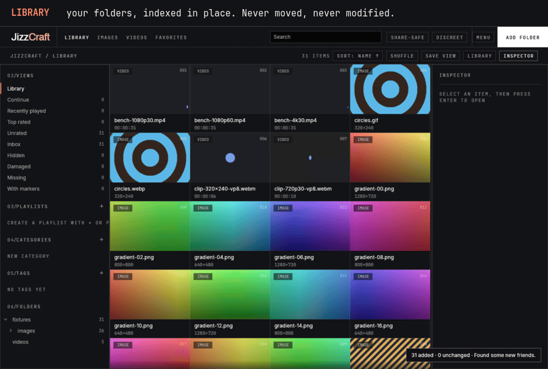
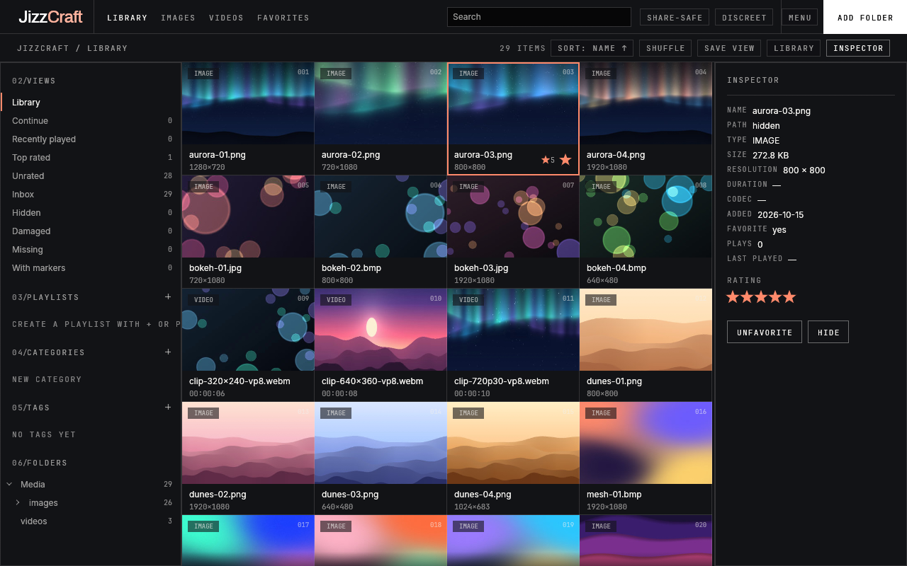
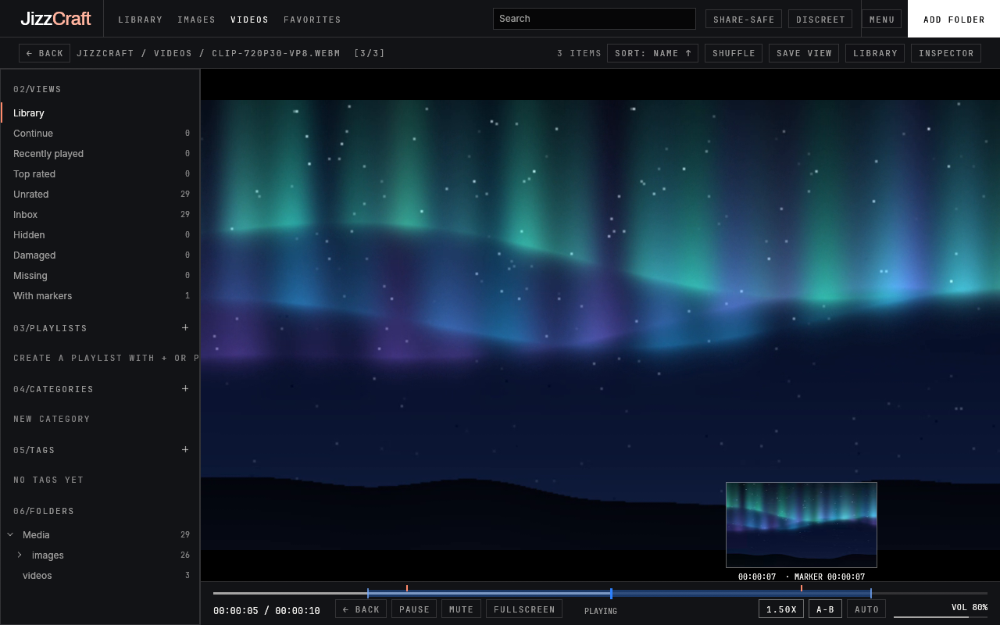
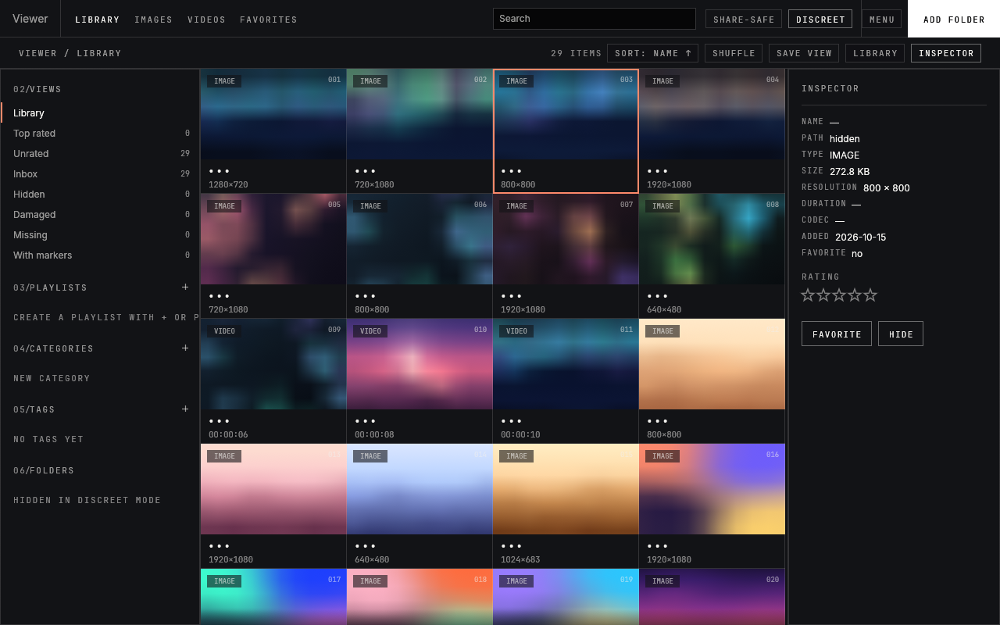
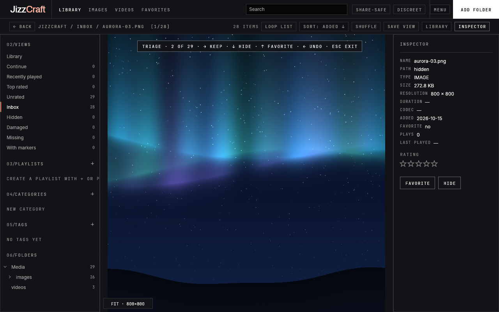

<p align="center"></p>
<h1 align="center">JizzCraft</h1>
<p align="center"><b>A private, offline library and player for your own adult collection.</b><br>
Your files stay where they are. Your history stays on your disk. Your browser history stays boring.</p>
<p align="center"><i>Offline by design: nothing leaves your machine, including your dignity.<br>No telemetry. Only shame, and that stays local too. Self-hosted, self-served.</i></p>
<p align="center">
  <a href="https://github.com/kerstz/JizzCraft/releases"></a>
  <a href="https://github.com/kerstz/JizzCraft/actions/workflows/ci.yml"></a>
  
  
  
  
  
</p>

<p align="center"></p>
<p align="center"><sub>Every app frame above was rendered by JizzCraft itself from synthetic, procedurally drawn test media (<a href="docs/media/make-demo.sh"><code>docs/media/make-demo.sh</code></a>); only the captions are added around it. No real media was harmed, or used.</sub></p>

> [!WARNING]
> **18+ only.** JizzCraft is for adults managing media they own or are entitled to keep. It ships no media, no sites and no catalogs. Everything in this repository (tests, fixtures, screenshots, the GIF) is synthetic and safe for work.

JizzCraft is a native Rust app (egui + wgpu, GStreamer, SQLite) that indexes the folders you point it at, then lets you browse, search, rate, tag, triage and play, without ever moving, renaming or modifying a file. No account, no telemetry, and the default build contains no network code at all.

<table>
  <tr>
    <td width="50%" valign="top">
      <h3>New here?</h3>
      Install it in one command, then follow the first launch step by step. No Rust or Linux expertise needed.<br><br>
      <a href="#new-here"><b>Install and first steps</b></a> · <a href="docs/getting-started.md">Getting started guide</a> · <a href="docs/getting-started.md#faq">FAQ</a>
    </td>
    <td width="50%" valign="top">
      <h3>Want to see how it's built?</h3>
      Crates and dependency rules, guarantees enforced by tests, the JSON CLI, threat model, perf budgets, CI you can run locally.<br><br>
      <a href="#want-to-see-how-its-built"><b>Architecture and guarantees</b></a> · <a href="docs/internals.md">Internals</a> · <a href="CONTRIBUTING.md">Contributing</a>
    </td>
  </tr>
</table>

## New here?

The short path: [install](#install), read [what you get](#why), look at the [status](#status-020-alpha). The step-by-step first launch, the everyday keys and the FAQ (where your data lives, uninstalling, a video that does not play) are in **[docs/getting-started.md](docs/getting-started.md)**.

### Install

**Linux, one command** (per user, under `~/.local`; it asks before installing your distribution's GStreamer packages and never runs `sudo` on its own):

```sh
curl --proto '=https' --tlsv1.2 -fsSL https://github.com/kerstz/JizzCraft/releases/latest/download/install.sh | sh
```

In a terminal it asks which edition you want (Offline is the default). It checks the SHA-256 of what it downloads, runs `jizzcraft-cli doctor` at the end and tells you exactly what is missing. Re-run it to update; `install.sh --uninstall` removes what it installed and nothing else (your library, settings and thumbnails are never touched). Options: `--edition offline|online`, `--with-browser`, `--prefix DIR`, `--version X.Y.Z`, `--from-source`, `--no-deps`, `--yes`, `--dry-run`, `--help`. What each step prints: [getting-started.md](docs/getting-started.md#install).

Other ways in, and the honest state of each:

| Platform | How | State |
| --- | --- | --- |
| Any Linux | the one-liner above | tested (Arch/CachyOS and the CI job *install*) |
| Debian / Ubuntu / Mint | `sudo apt install ./jizzcraft_*.deb` from the release page | built and checked by CI |
| Arch / CachyOS / Manjaro | `makepkg -si` in [`packaging/arch/jizzcraft`](packaging/arch/jizzcraft) | recipe only, not on the AUR yet |
| Fedora / openSUSE | [`packaging/fedora/jizzcraft.spec`](packaging/fedora/jizzcraft.spec) | recipe only, no prebuilt rpm |
| Flatpak, AppImage | recipes in [`packaging/`](packaging) | not built or published yet |
| Windows 10/11 | portable zip and installer, when the CI job succeeds ([docs/windows.md](docs/windows.md)) | **experimental**, never run on real hardware, may be absent from a release |
| macOS | build from source | compiles, no bundle published, never run on real hardware |

A build nobody has run is like a letter nobody has opened: probably fine. See [docs/audit-untested.md](docs/audit-untested.md) for the full list of what has and has not been exercised.

**Something does not play?** `jizzcraft-cli doctor` (or `jizzcraft --doctor`) lists which GStreamer pieces are present (H.264, HEVC, AV1, VP9, AAC, Opus, hardware decoding), checks that the data, config and cache folders are writable, and prints the one command that fixes what is missing for your distribution. More in [Troubleshooting](#troubleshooting).

**Verify a download:**

```sh
sha256sum -c --ignore-missing SHA256SUMS
gh attestation verify jizzcraft-*-linux.tar.xz --repo kerstz/JizzCraft   # build provenance
```

### Why

Because the usual options are a general-purpose media player that forgets everything, a self-hosted media server with a web UI and an account system for an audience of one, or a folder called `homework`.

- **Your files are read, never touched.** No moves, no renames, no sidecar files, no tags written into your media. Ratings, history and markers live in one SQLite database. A test hashes a media tree before and after every engine command. Someone in this relationship has to keep their hands to themselves.
- **Offline is a build property, not a setting.** The default build does not contain a network stack, and a test fails if one sneaks into the dependency tree. GStreamer's network-capable elements are removed from the app's registry at start-up, so a streaming playlist renamed to `.mp4` is refused, not fetched. It doesn't ignore the internet; it has never heard of it.
- **Discreet when it matters.** `Ctrl+Shift+H` is a boss key (pause, mute, discreet mode, minimize). `Ctrl+Shift+M` is a panic switch: it jumps full-screen, with sound, to a local video you chose in advance (Library menu, Privacy, "Panic video"), turns discreet mode on and records nothing in history; with no video chosen it acts as the boss key. Discreet mode retitles the window "Viewer", swaps the icon, hides names and blurs thumbnails. Share-safe mode blurs everything until hovered. A neutral "Viewer" launcher starts the app disguised. Your alibi plays at full volume.
- **Keyboard first, one hand if you like.** Arrows, `Enter`, `/` to search, `V` to triage new imports, `R` for a random pick. A left-hand preset puts browsing, playback, ratings and the boss key around `WASD` ([details](#one-hand-is-enough)), which is also a motor-accessibility setting. Gamers will feel right at home; that is the explanation we are going with.
- **Native and fast.** A virtualized grid that renders only visible rows and loads only a window of them from SQLite, thumbnails in a background pool, playback paced by the GStreamer clock. Measured, including where it is slow ([docs/bench.md](docs/bench.md)). Blazingly fast (the Rust community requires us to say this), blazingly discreet (the part you care about).
- **Scriptable.** One registry of named commands drives the menus, the shortcuts, a JSON CLI and `--cmd` ([Built for agents](#built-for-agents)). Yes, you can automate it. No, we won't ask why.

### A look around

<table>
  <tr>
    <td width="50%"></td>
    <td width="50%"></td>
  </tr>
  <tr>
    <td width="50%"></td>
    <td width="50%"></td>
  </tr>
</table>

Screenshots are rendered by the app itself (`cargo xtask screenshots`, 1280×800, English) from synthetic media.

### Two editions

One code base, one `main` branch, two builds. The editions are two release tarballs made from the same commit; the only difference is the off-by-default Cargo feature `network` (alias `online`).

| | **Offline** (default) | **Online** |
| --- | --- | --- |
| Network code | **None.** Not compiled, not linked. A test fails if a network crate enters the dependency tree. | Opt-in, behind explicit switches. Nothing connects before you act. |
| What it is | A private library and player for files already on your disk. | The same app, plus tools to find and play things from sources **you** configure: Torznab indexers, BitTorrent, HLS/DASH streaming, page resolvers, "Send to JizzCraft", an optional separate browser ([details](#the-online-edition)). |
| Build | `cargo build --release -p jizzcraft` | `cargo build --release -p jizzcraft --features online` |
| Release file | `jizzcraft-<version>-<arch>-linux.tar.xz` | `jizzcraft-online-<version>-<arch>-linux.tar.xz` |
| Install | `install.sh` (or `--edition offline`) | `install.sh --edition online` |
| Proxy / VPN kill switch | n/a | yes: with it on, nothing connects unless your proxy or VPN interface is set |

Library, settings and thumbnails are shared, so switching editions loses nothing. JizzCraft ships **no site, indexer, tracker, source or catalog** in either edition. Details: [docs/editions.md](docs/editions.md).

### Status: 0.2.0, alpha

> [!IMPORTANT]
> JizzCraft is **alpha software**, held together by clippy and optimism. It works, it is tested, and it will still have rough edges and change between versions. Keep a backup of anything you cannot replace (`jizzcraft-cli` has a backup command).

- **Platforms.** Linux is the only tested platform (one main machine: H.264, VA-API, AMD GPU, Wayland). Windows and macOS compile and are built by CI, but have never run on real hardware; the Windows files may be missing from a release when that job fails.
- **Verified by automated tests**: scan, search, favorites, ratings, hide/inbox, history, markers, filters, saved views, folder tree, stable shuffle, fingerprint relink, backup and metadata export/import, bit-rot detection, schema migration; thumbnails, scrub previews, integrity checks; the player state machine on a real GStreamer pipeline; the network guard; keymap invariants (no duplicate chords, physical keys on AZERTY); 18 end-to-end scenarios (`cargo xtask e2e`, a required CI check) and performance budgets (`cargo xtask perf`).
- **Only checked through commands and screenshots, not by hand**: mouse wheel zoom, drag-panning, timeline dragging, fullscreen, boss-key minimize under different compositors, the native folder dialog, triage, the player bar chips, autoplay, slideshow, and the unlocked vault's Settings flow (covered by tests, never seen on screen by the maintainers; the lock screen and the Privacy page are rendered by `cargo xtask screenshots` and were checked).
- **Upgrading from 0.1.0**: the library migrates in place on first start, after writing a backup next to it; 0.1.0 cannot open it again afterwards (restore the backup to go back). Checked with a library created by the 0.1.0 binary.
- **Known gaps**: CPU use on high-resolution video is 3 to 6 times `gst-play-1.0` (colour conversion runs on the CPU; a shader is on the [roadmap](ROADMAP.md)); subtitles are local `.srt` / `.vtt` sidecars only; no file watching (rescan is manual); AVIF is not decoded; GStreamer parses imported videos without a sandbox.
- **Streaming (Online edition, experimental)**: direct video addresses, HLS (on demand and live) and DASH on demand. Not supported: live DASH, low-latency HLS, TS or WebM separate audio, DRM, subtitles for streams.

What changed in this version: [CHANGELOG.md](CHANGELOG.md).

### Features

**Library.** Import a folder (native dialog) and JizzCraft indexes images and videos recursively. Symbolic links and hidden folders are skipped, Unicode names are fine, duplicate imports are no-ops, and a file that went missing stays flagged instead of silently dropped. Search is full text (SQLite FTS5) over file names, tags, categories and marker labels: case and accent insensitive, every word a prefix. Filter by Images / Videos / Favorites, sort by name, date added, size, duration, rating or play history.

- **Views**: Continue, Recently played, Top rated, Unrated, Inbox, Hidden, Damaged, Missing, With markers, plus your own saved views and a folder tree with counts.
- **Organise**: 0–5 star ratings, a reversible *hide* (a database flag, nothing else), playlists, categories (a tree) and tags; private tags and categories are not indexed for search. Multi-select with bulk rate, favorite, hide and "Add to". See [docs/organise.md](docs/organise.md).
- **Inbox triage**: review new imports one at a time with `V`: keep, hide, favorite, undo. Nothing is ever deleted. Tinder for files, without the matches and without the regrets.
- **Moves are recognised**: once files are fingerprinted (size plus the first and last 64 KiB), a renamed or moved file keeps its rating, history and markers at the next rescan. It judges a file by its cover and its last page. You can rename `definitely_not_that.mp4` all you like; it will still know.
- **Shuffle** that never repeats or skips while paging, a **random pick** (`R`) and a **slideshow** (`T`).

**Viewer and player.**

- **Images**: PNG, JPEG, WebP, GIF (first frame), BMP. Fit, 100 %, wheel zoom around the cursor, pan, EXIF orientation honoured.
- **Videos**: whatever your GStreamer can decode (extensions `mp4 mkv webm mov avi m4v wmv flv mpg mpeg ts ogv`). One persistent wgpu texture, coalesced scrub seeks, readable errors that name the missing plugin.
- **Resume and history**, with a pause switch, a clear button and a hide setting.
- **Speed** 0.5×–2× from the bar (0.25×–4× by command, pitch preserved with `scaletempo`), **A-B loop** (`L`), **markers** (`K` adds, `N` / `Shift+N` jump), **frame step** (`,` / `.`), **scrub previews** on the timeline (blurred in discreet mode).
- **Subtitles** from a `.srt` or `.vtt` sidecar with the same base name (`clip.fr.srt` for a language), with timing shift.
- **Autoplay-next** with a three-second countdown that `Esc` cancels. Three seconds is enough time to reconsider your choices, or not.

**Maintenance and portability.**

- **Integrity check**: quick or full decode test, plus an opt-in checksum that flags silent corruption.
- **Backup** (`VACUUM INTO`, never overwrites), **metadata export/import** keyed by fingerprint (names and history opt-in), **portable mode** (`--portable`, `--home`, `JIZZCRAFT_HOME`).

**Languages and playful messages.** English, French, Spanish, German, Italian and Portuguese, following your system locale (or `--lang fr`). A few playful one-liners show up in empty states and toasts; they can be switched off, and are **always off** in discreet mode, share-safe mode and the disguised launch, so nothing cheeky appears on a shared screen.

### One hand is enough

*The left-hand preset keeps every routine action under one hand, so the other stays free for a mouse, a remote or a coffee.*

Turn it on once: press `?` in the library and click *Left-hand keys*, or start the app with `jizzcraft --cmd app.left_hand.toggle`. The choice is saved. Letters match the physical key, so on AZERTY the same keys sit under `ZQSD`.

| | Library | Image viewer | Video player |
| --- | --- | --- | --- |
| Move / step | `W` `A` `S` `D` move the selection | `A` / `D` previous / next | `A` / `D` back / forward 5 s |
| Open / play | `E` or `Space` | | `Space` play / pause |
| Up / down | | `W` / `S` zoom, `Z` fit | `W` / `S` volume |
| Favorite | `F` | `F` | `F` |
| Back | `Q` clears the search | `Q` back to the library | `Q` leaves fullscreen, then goes back |
| Also | `1`–`4` switch tabs | `X` hide / unhide | `X` mute, `G` fullscreen, `Shift+A` / `Shift+D` previous / next item |

Anywhere: `Alt+1`–`Alt+5` rate, `Ctrl+O` import, `Ctrl+R` rescan, `Ctrl+Shift+H` boss key, `Ctrl+Shift+M` panic switch, `Ctrl+Shift+L` lock the encrypted library (vault only). Inbox triage: `D` keep, `S` or `X` hide, `W` favorite, `A` undo, `Q` leave. Press `?` in the app for the full list of both presets (it is generated from the same table the app uses).

**Honest footnote: what still wants the other hand or a pointer.** Turning the preset on (one click, or the `--cmd` above); `?`, `/` and typing a search, `Home` / `End`, `Alt+0`; the system folder picker behind `Ctrl+O`; dragging the timeline, panning a zoomed image, the sidebar, sorting, the inspector and the player-bar chips; seeking during triage. The bindings are checked by tests as a table but have not been verified by hand yet.

### FAQ

<details>
<summary><b>Legality, Rust, the cloud, visitors and more</b></summary>

**Is this legal?** It is a media library and player, about as legal as a file manager with a nicer grid. JizzCraft ships no media, no sites, no indexers and no catalogs. It is for adults (18+) managing media they own or are entitled to keep; what you put in it, or search for and download with the Online edition, is your responsibility.

**Why Rust?** Because if anything was going to crash in the middle of playback, it was not going to be us. Rust gives a native app with no garbage-collector pauses, and tests that can prove things like "no network crate in the default build". Also, we were legally required to mention it in the title (we were not).

**Where is the cloud?** Above your house, where it belongs. The default (Offline) build has no network code at all, not compiled and not linked, and a test fails if any appears. Your library is one SQLite database on your own disk.

**Does it phone home?** It does not even know where home is. No account, no telemetry, no update check: the app never contacts GitHub by itself. You update by re-running the installer.

**Will it rename, move or "organise" my files?** No. Ratings, tags, history and markers live in the database; your files are read, never written. Even "hide" is just a flag.

**What if someone walks in?** Practise the chord now. `Ctrl+Shift+H` is the boss key and `Ctrl+Shift+M` the panic switch (see [Discreet when it matters](#why)). The minimize step has not been checked by hand under every compositor, so do a dry run first.

**Can I encrypt the library?** Yes, with the [vault](docs/vault.md) (alpha, off by default). There is no recovery: that is not a missing feature, it is the feature. Write the passphrase down somewhere that is not a file called `passphrase.txt`.

**Windows or macOS?** In theory, enthusiastically. Both compile in CI, but neither has ever run on real hardware (see [Status](#status-020-alpha)). Brave testers welcome, discretion guaranteed.

</details>

### Troubleshooting

- **"missing GStreamer plugin: …"**: install `gst-plugins-good/bad/ugly` and `gst-libav`, or run `jizzcraft-cli doctor`.
- **"refused: this file refers to network media…"**: the file is a streaming playlist or SDP description, not a video. The Offline edition does not follow the URLs inside it, by design, and neither will asking nicely.
- **Black window or wgpu error at startup**: check your Vulkan driver (`vulkaninfo`). A black window is discreet, but not the kind of discreet we were going for.
- **Need file names in logs**: run with `JIZZCRAFT_DEBUG=1`, and redact before sharing. An issue tracker is a very public place to find out what your files are called.

More in [docs/troubleshooting.md](docs/troubleshooting.md) and the [FAQ](docs/getting-started.md#faq).

## Want to see how it's built?

The short path: the [crate layout](#under-the-hood), the [guarantees and the tests that enforce them](#privacy-guarantees-checked-by-tests), the [command registry](#built-for-agents). The full map (dependency rules, runtime model, `cargo xtask`, threat model, perf budgets, every CI job and how to run it locally) is **[docs/internals.md](docs/internals.md)**.

### Under the hood

```
crates/core    model, SQLite (versioned schema + migrations), scan, command registry. No UI, no GStreamer.
crates/media   thumbnails, codec probing, GStreamer player, network guard
crates/fetch   indexers, BitTorrent, streaming (Online edition only, behind the `network` feature)
crates/bridge  line protocol to the optional browser helper (no network code)
crates/ui      egui app: theme, grid, viewer, player, inspector
apps/          desktop app (eframe + wgpu), CLI on the same registry, optional browser helper
xtask          fixtures, icons, screenshots, packaging, e2e, perf
```

- **Engine first.** `core` has no UI and no GStreamer dependency; `media` never depends on `fetch`; the default apps do not link `fetch` (tested).
- **Local by construction.** Pipelines only get `file://` URIs. Network-capable GStreamer elements (HTTP/RTSP/UDP sources, HLS/DASH/Smooth Streaming/SDP demuxers) are removed from the app's own plugin registry at start-up, and every pipeline is watched for anything that slips through ([`crates/media/src/guard.rs`](crates/media/src/guard.rs)). The system registry is untouched.
- **The UI thread never touches the pipeline.** A control thread builds, drives and tears down GStreamer; the UI takes the newest frame from a one-slot mailbox.
- **No async runtime** in the app, library or player: `std::thread` and channels. Plumbing, not wizardry. (`tokio` exists only inside `crates/fetch` in the Online build, and is banned from the default dependency tree.)
- **Performance, measured.** No dropped frames on 1080p30, 1080p60 and 4K30 H.264 on the test machine, **but 3 to 6 times the CPU of `gst-play-1.0`** because colour conversion runs on the CPU. Numbers in [docs/bench.md](docs/bench.md); library budgets on a synthetic 10k library in [docs/perf.md](docs/perf.md).

"Written in Rust" is about the code in this repository: video decoding is the system's GStreamer, and the library uses SQLCipher (an SQLite fork) with a vendored OpenSSL, all C.

### Privacy guarantees checked by tests

Promises are cheap, so here is where each one is enforced. If one of these tests goes red, the claim is wrong and the build is broken. The longer table is in [docs/internals.md](docs/internals.md#guarantees-checked-by-tests).

| Guarantee | Enforced by |
| --- | --- |
| The default build contains no network crate (HTTP, TLS, sockets libraries) | [`crates/core/tests/offline_deps.rs`](crates/core/tests/offline_deps.rs): runs `cargo tree`, with a positive control proving the check can see network crates |
| The player, thumbnails, probes, scrub previews and integrity checks open **zero** connections, even when fed HLS/DASH playlists disguised as videos | [`crates/media/tests/network.rs`](crates/media/tests/network.rs): a local listener counts connections |
| The engine never modifies, moves or deletes your media | `engine_never_touches_media` in [`crates/core/tests/portability.rs`](crates/core/tests/portability.rs): hashes a tree before and after every command |
| The library schema only grows; old migrations are never edited | `migrations_are_frozen` in [`crates/core/tests/migrations.rs`](crates/core/tests/migrations.rs) |
| Paths are turned into stable opaque tags before they reach logs (full paths only with `JIZZCRAFT_DEBUG=1`) | `redacted_paths_are_stable_opaque_tags` in [`crates/core/src/privacy.rs`](crates/core/src/privacy.rs) |
| Online edition: the kill switch means zero connections | e2e scenario `s14_kill_switch_means_zero_connections` in [`tests/e2e/tests/scenarios.rs`](tests/e2e/tests/scenarios.rs) |
| Online edition: indexer and source keys never reach errors, debug output or listings | [`crates/fetch/tests/security.rs`](crates/fetch/tests/security.rs) |

And the rules that are design, not tests:

- No accounts, telemetry, analytics, cloud sync, update checks or ads, in any build.
- No shell commands built from file names; paths are passed as arguments.
- Thumbnails and previews go to the XDG cache directory (or the portable home), never next to your files.
- History is aggregate (count, last played, resume point), never an event log. It can be paused, cleared (and truncated out of the WAL file) or hidden.
- Files on network mounts (NFS, SMB, sshfs) are read through your OS like any other file. `--bench-gst-play` runs the external `gst-play-1.0`, which the guard does not cover.
- The age gate, discreet mode and share-safe mode are conveniences, not security boundaries.

**Encrypted vault (alpha, off by default).** Settings > Privacy > *Encrypt library* (or `jizzcraft-cli vault enable`) encrypts the library database and the thumbnails with a passphrase (SQLCipher), adds a lock screen and an inactivity lock. It protects the database and thumbnails against someone holding a copy of your disk while the app is closed or locked. It does **not** protect your media files, a running unlocked machine, `config.json` / `fetch.json`, JSON exports, or data written in clear before you enabled it. **There is no recovery**: forget the passphrase and your tags, notes and history are gone (your media files are untouched). Read [docs/vault.md](docs/vault.md) before relying on it.

What is in scope for a security report, and what is not: [SECURITY.md](SECURITY.md).

### Built for agents

Menus, shortcuts, the CLI and `--cmd` all call the same command registry.

```sh
jizzcraft-cli scan ~/Videos --json
jizzcraft-cli query --type video --name holiday --json
jizzcraft-cli rate 42 5 && jizzcraft-cli query --min-rating 4 --sort rating --desc --json
jizzcraft-cli query --view inbox --json     # built-in and saved views
jizzcraft-cli fingerprint --all && jizzcraft-cli check --full --checksum
jizzcraft-cli export meta.json && jizzcraft-cli import meta.json --dry-run
jizzcraft-cli run history.list '{"limit":10}'   # any registered command
jizzcraft-cli commands                # list registered commands

# drive the desktop app
jizzcraft --import ~/Videos --cmd 'view.filter={"tab":"Videos"}' --cmd 'media.open={"index":0}'
jizzcraft --cmd triage.start
```

See [`AGENTS.md`](AGENTS.md) for the conventions agents (and humans) should follow.

### Build from source

Rust 1.95 or newer, GStreamer with development headers, a C compiler with `make` and `perl` (SQLCipher's vendored OpenSSL), and a Vulkan driver. Package lists for Arch, Debian/Ubuntu and Fedora: [docs/internals.md](docs/internals.md#build-test-and-run-ci-locally).

```sh
git clone https://github.com/kerstz/JizzCraft && cd JizzCraft
cargo xtask fixtures                                   # safe, synthetic test media in ./fixtures
cargo run --release -p jizzcraft -- --import fixtures  # try it without your own files
```

Development: `cargo fmt`, `cargo clippy --workspace --all-targets -- -D warnings`, `cargo test --workspace`, `cargo xtask e2e`, `cargo xtask perf`, `cargo xtask screenshots` (README images rendered by the app). Every CI job, and the command that reproduces it locally, is listed in [docs/internals.md](docs/internals.md#build-test-and-run-ci-locally).

## The Online edition

Each tool is opt-in, none is preset: **you bring the indexers, trackers and sources.** Nothing connects before you act, and the kill switch (Settings → Connection) makes everything refuse to connect unless your proxy or VPN interface is set.

| Tool | What it does |
| --- | --- |
| **One box** | `Ctrl+J`: paste a video link, a `.m3u8`/`.mpd`, a page address, a magnet, a `.torrent`, a `.json` source, or search words. It picks the right path. |
| **Streaming** | Seekable HTTP, HLS and DASH (AES-128, quality chip, buffered band), live HLS, separate fragmented-MP4 audio/video tracks. Nothing written to disk. |
| **Web pages** | A tool **you** installed (a yt-dlp-class program) turns a page address into a video address. It never bypasses a site's age check, sign-in, region block or DRM, and never reads another browser's cookies. |
| **Torrents** | Play while it downloads, seek moves the download priority, disk-space checks, no seeding after completion by default, optional binding to a VPN interface. Torrents never overwrite or delete files. |
| **Indexers and sources** | Your own Torznab endpoints (Jackett/Prowlarr) and JSON source definitions. Keys live only in `fetch.json` (mode 0600). |
| **Optional browser** | A separate WebKitGTK process, never linked into the app: private session, popups and downloads blocked, traffic forced through your proxy. See [docs/browser.md](docs/browser.md). |

What it exposes: your IP is visible to the indexers you configure, to BitTorrent peers and to the sites you open. What you search for and download is your responsibility. Details: [docs/streaming.md](docs/streaming.md), [docs/editions.md](docs/editions.md).

## Roadmap

YUV→RGB in a shader, embedded subtitles and audio tracks for local files, perceptual-hash duplicates, file watching, sandboxed decoding, AUR/Flatpak/AppImage, and real-hardware runs on Windows and macOS. The full list, including what is explicitly not planned, is in [ROADMAP.md](ROADMAP.md). Features are proposed and voted on in the open: [docs/feature-process.md](docs/feature-process.md). The app never contacts GitHub by itself.

## Contributing and security

Read [CONTRIBUTING.md](CONTRIBUTING.md), [AGENTS.md](AGENTS.md) and the [code of conduct](CODE_OF_CONDUCT.md). Issues labelled [`good first issue`](https://github.com/kerstz/JizzCraft/issues?q=is%3Aissue+is%3Aopen+label%3A%22good+first+issue%22) are a good place to start. Contributions never include real adult content: fixtures and screenshots are synthetic. Report vulnerabilities privately as described in [SECURITY.md](SECURITY.md); legal and trademark requests are covered in [LEGAL.md](LEGAL.md). All documentation, sorted by who it is for: [docs/README.md](docs/README.md).

## License and credits

Dual-licensed under [MIT](LICENSE-MIT) or [Apache-2.0](LICENSE-APACHE), at your option. Third-party notices: [NOTICE](NOTICE) and [ATTRIBUTION.md](ATTRIBUTION.md); release archives also carry a `THIRD-PARTY.html`.

**Inspiration.** The idea started in a discussion thread on r/linuxmemes, ["Not another one"](https://www.reddit.com/r/linuxmemes/comments/1x454bj/not_another_one/). Its remarks on accessibility, one-handed use and repetitive filtering shaped the keyboard-first design and the left-hand key preset. No content from the thread is reproduced here.

<sub>JizzCraft is an independent project, not affiliated with, sponsored or endorsed by ArtCraft, Crafting Apps or any other product or company. All code, icons and screenshots are its own; screenshots are synthetic.</sub>
