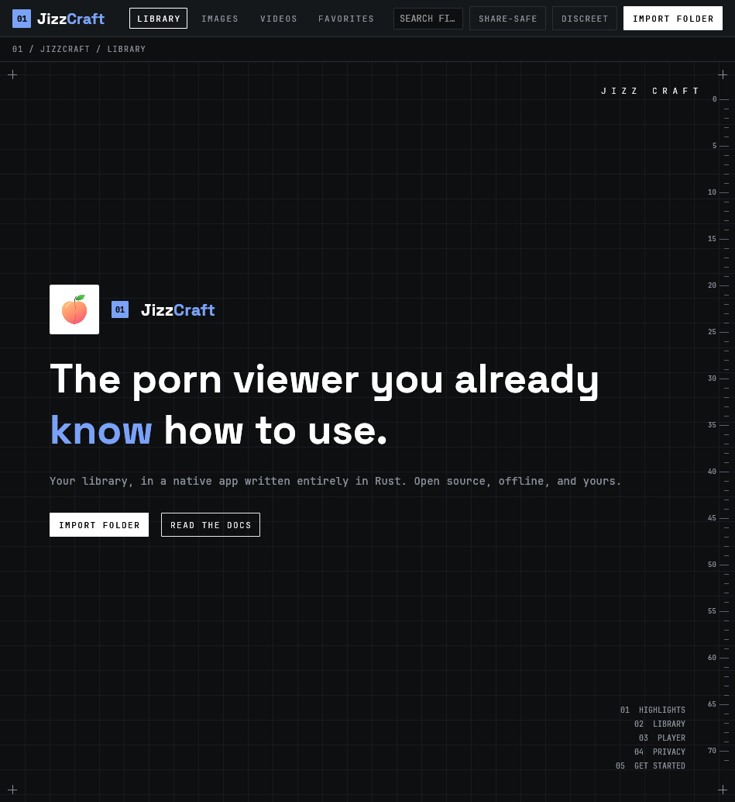
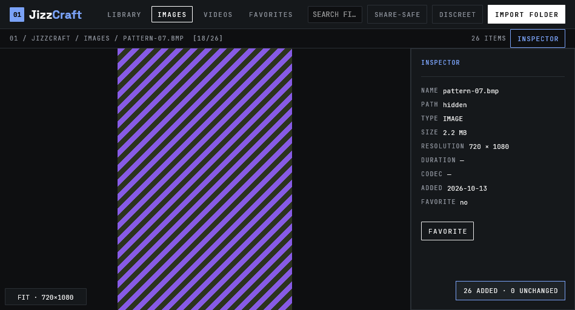
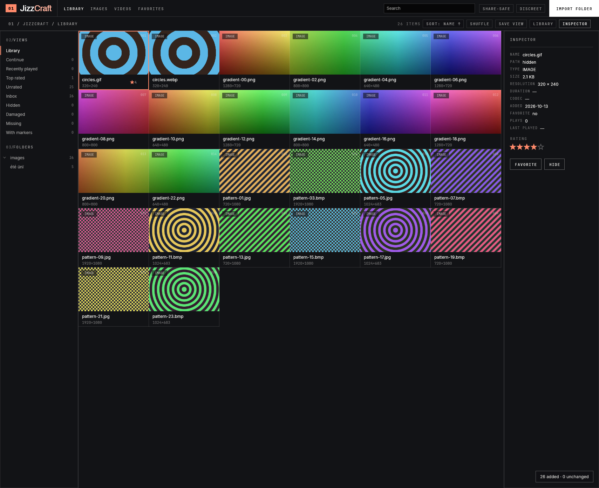

<p align="center"></p>
<h1 align="center">JizzCraft</h1>
<p align="center"><b>A private, offline media library and player for your own adult collection.</b></p>
<p align="center">Native Rust app for Linux (Windows and macOS experimental). No account, no telemetry, no network in the default build. 18+ only.</p>
<p align="center">
  
  
  
  
</p>
<p align="center">
  <a href="#a-look-around">A look around</a> · <a href="#why-jizzcraft">Why JizzCraft</a> · <a href="#downloads">Downloads</a> · <a href="#built-for-agents">For agents</a> · <a href="#privacy-guarantees">Privacy</a> · <a href="#status">Status</a> · <a href="#license-and-credits">License</a>
</p>

## Two editions

JizzCraft ships as two editions of the same code base. Pick the one that fits how you use it; you can switch at any time and your library, settings and thumbnails are shared.

| | **Offline edition** | **Online edition** |
| --- | --- | --- |
| Network code | **None.** Not linked, not compiled. A test fails if a network crate enters the dependency tree. | Opt-in, behind clear switches. Nothing connects before you act. |
| What it is | A private library and player for the files already on your disk. | The same app plus tools to find and play things: indexers, torrents, streaming from your own sources, web-page resolvers, "Send to JizzCraft" and an optional built-in browser. |
| Built from | the default build | `--features online` (alias of `network`) |
| Branch | [`edition/offline`](../../tree/edition/offline) | [`edition/online`](../../tree/edition/online) |
| Release files | `jizzcraft-<version>-…` | `jizzcraft-online-<version>-…` (`install.sh --edition online`) |
| Proxy / VPN kill switch | n/a | yes: nothing connects without your proxy when you ask for it |

`main` is where both editions are developed; the two branches are the release channels for each edition.

> [!IMPORTANT]
> **Alpha software (v0.1).** It works and it is tested, but expect rough edges and changes between versions. Linux is the tested platform; Windows and macOS compile but have not been run on real machines yet. Streaming from your own sources (HLS/DASH, resolvers) is new and experimental. Your media is never modified, and the library schema only ever grows through migrations, but keep a backup of anything you cannot replace (`jizzcraft-cli` has a backup command).

A fast native app for your own images and videos: browse, search, rate, tag and play, with your files left exactly where they are. Open source, offline by default, no account, no telemetry. Written in Rust for Linux, Windows and macOS.


> "100% Rust" is about the code in this repository. Video decoding is delegated to the system's GStreamer and the library uses SQLite (bundled by `rusqlite`); both are C.

> [!WARNING]
> **18+ only.** JizzCraft is intended for adults managing media they own or are entitled to keep. It ships no media. The default build downloads nothing and opens no network connections. All test data, fixtures and screenshots in this repository are synthetic and safe for work.

The claims below are checked by tests: the default build links no network code, and your files are only ever read.

> "Written in Rust" is about the code in this repository. Video decoding is delegated to the system's GStreamer and the library uses SQLite (bundled by `rusqlite`); both are C.

## A look around

<table>
  <tr>
    <td width="50%"></td>
    <td width="50%"></td>
  </tr>
  <tr>
    <td width="50%"></td>
    <td width="50%"></td>
  </tr>
</table>

Screenshots are rendered by the app itself (`cargo xtask screenshots`) from synthetic media.

## Why JizzCraft

- 🎛️ **Simple by design.** A top bar, a grid, an inspector. Add a folder and see your files; everything is reachable with the mouse and with the keyboard.
- ⌨️ **Keyboard first.** Arrow keys move through the grid, `Enter` opens, `/` searches, `1`–`4` switch tabs.
- ✋ **One hand is enough.** A left-hand preset puts browsing, opening, playback, seeking, volume, favorites, ratings and the boss key around `WASD`. [Details and honest footnote below](#one-hand-is-enough).
- ⚡ **Native and fast.** egui + wgpu, SQLite, a virtualized grid that never loads the whole library, GStreamer playback paced by the pipeline clock.
- 🔒 **Private by default.** No account, no telemetry, and the default build makes no network connections: GStreamer's network-capable elements are switched off inside the app, so even a streaming playlist renamed to `.mp4` is refused, not fetched. A boss key, a discreet mode and a screen-share-safe mode are built in.
- 🤖 **Agent-ready.** One registry of named commands drives the menus, the shortcuts and a JSON CLI.

## Downloads

**Linux, one command** (per-user, no root except for your distribution's GStreamer packages, which it asks before installing):

```sh
curl --proto '=https' --tlsv1.2 -fsSL \
  https://github.com/kerstz/JizzCraft/releases/latest/download/install.sh | sh
```

Run with no flags in a terminal and it asks which edition you want (Offline is the default) and whether to add the optional browser. It checks the SHA-256 of what it downloads, installs under `~/.local`, runs `jizzcraft-cli doctor` at the end and tells you exactly what is missing and how to fix it. Re-run it to update; `install.sh --uninstall` removes what it installed and nothing else (your library, settings and thumbnails are never touched). Options: `--edition offline|online`, `--with-browser`, `--prefix DIR`, `--version X.Y.Z`, `--from-source`, `--no-deps`, `--yes`, `--dry-run`, `--help`.

| Platform | Install | Update | Uninstall |
| --- | --- | --- | --- |
| Any Linux | the one-liner above | run it again | `install.sh --uninstall` |
| Debian / Ubuntu / Mint | `sudo apt install ./jizzcraft_*.deb` from the release page | install the new `.deb` | `sudo apt remove jizzcraft` |
| Arch / CachyOS / Manjaro | `makepkg -si` in `packaging/arch/jizzcraft` (not on the AUR yet) | pull, run it again | `sudo pacman -Rns jizzcraft` |
| Fedora / openSUSE | build with `packaging/fedora/jizzcraft.spec` (no prebuilt rpm yet) | rebuild | `sudo dnf remove jizzcraft` |
| Flatpak, AppImage | recipes in `packaging/`, not built or published yet | n/a | n/a |
| Windows 10/11 | portable zip and installer on the release page (**experimental**, never run on real hardware) | download the new one | uninstaller, or delete the folder |
| macOS | build from source (no bundle is published) | n/a | n/a |

Honest status: the `install.sh` flow, the `.deb` contents, the staging tree, the desktop and AppStream files and `doctor` are exercised on Arch/CachyOS and by the CI job *install*. The Arch, RPM, Flatpak and AppImage recipes are written against the same staging tree (`cargo xtask dist`) but are not built by CI yet; Windows and macOS have never run on a real machine (a build nobody has run is like a letter nobody has opened: probably fine). See [docs/audit-untested.md](docs/audit-untested.md).

### Something does not play?

```sh
jizzcraft-cli doctor        # or: jizzcraft --doctor
```

It lists which GStreamer pieces are present (H.264, HEVC, AV1, VP9, AAC, Opus, hardware decoding), checks that the data, config and cache folders are writable, and prints the one command that fixes what is missing for your distribution. Exit status: 0 fine, 1 something required is missing, 2 only codecs are missing. The app never runs `sudo` itself.

### Verify a download

```sh
sha256sum -c --ignore-missing SHA256SUMS
gh attestation verify jizzcraft-*-linux.tar.xz --repo kerstz/JizzCraft   # build provenance
```

### Hide the launcher entry

Copy `/usr/share/applications/io.github.kerstz.JizzCraft.desktop` to `~/.local/share/applications/` and add `Hidden=true`. The neutral "Viewer" entry (`local.Viewer.desktop`) starts the same program disguised.

The release workflow (`.github/workflows/release.yml`) builds the Linux artifacts on tags, using the oldest supported runner so the binaries run on Debian 12 and newer.

## Quick start

Building from source.

Rust 1.95 or newer (the minimum of egui 0.36; developed with 1.98), GStreamer with development headers, and a GPU driver: Vulkan is the tested backend (wgpu's OpenGL ES fallback is compiled in but untested).

### Dependencies (Arch / CachyOS)

```sh
sudo pacman -S --needed rust gstreamer gst-plugins-base gst-plugins-good \
  gst-plugins-bad gst-plugins-ugly gst-libav vulkan-icd-loader \
  xdg-desktop-portal xdg-desktop-portal-gtk
# plus a Vulkan driver for your GPU, e.g. vulkan-radeon, vulkan-intel or nvidia-utils
```

### Dependencies (Debian / Ubuntu, Fedora)

```sh
# Debian / Ubuntu (the CI job uses this list)
sudo apt install build-essential pkg-config libgstreamer1.0-dev \
  libgstreamer-plugins-base1.0-dev gstreamer1.0-tools gstreamer1.0-plugins-base \
  gstreamer1.0-plugins-good gstreamer1.0-plugins-bad gstreamer1.0-plugins-ugly \
  gstreamer1.0-libav libvulkan1 mesa-vulkan-drivers xdg-desktop-portal xdg-desktop-portal-gtk

# Fedora (untested; H.264 needs RPM Fusion's gstreamer1-libav)
sudo dnf install gcc pkgconf-pkg-config gstreamer1-devel gstreamer1-plugins-base-devel \
  gstreamer1-plugins-base-tools gstreamer1-plugins-good gstreamer1-plugins-bad-free \
  gstreamer1-plugins-ugly-free vulkan-loader mesa-vulkan-drivers \
  xdg-desktop-portal xdg-desktop-portal-gtk
```

### Build and run

```sh
git clone <this repository> && cd JizzCraft
cargo run --release -p jizzcraft
```

### Try it on safe, synthetic media

```sh
cargo xtask fixtures          # gradients, patterns and short test videos in ./fixtures
cargo run --release -p jizzcraft -- --import fixtures
```

### Development

```sh
cargo fmt
cargo clippy --workspace --all-targets -- -D warnings
cargo test --workspace
cargo xtask icons             # rasterize the SVG icons with resvg
cargo xtask screenshots       # render README images through the app itself
```

## One hand is enough

*The left-hand preset keeps every routine action under one hand, so the other stays free for a mouse, a remote or a coffee. It is also a motor-accessibility setting.*

Turn it on once: press `?` in the library and click *Left-hand keys*, or start the app with `jizzcraft --cmd app.left_hand.toggle`. The choice is saved. Letters match the physical key, so on AZERTY the same keys sit under `ZQSD`.

| | Library | Image viewer | Video player |
| --- | --- | --- | --- |
| Move / step | `W` `A` `S` `D` move the selection | `A` / `D` previous / next | `A` / `D` back / forward 5 s |
| Open / play | `E` or `Space` | | `Space` play / pause |
| Up / down | | `W` / `S` zoom, `Z` fit | `W` / `S` volume |
| Favorite | `F` | `F` | `F` |
| Back | `Q` clears the search | `Q` back to the library | `Q` leaves fullscreen, then goes back |
| Also | `1`–`4` switch tabs | `X` hide / unhide | `X` mute, `G` fullscreen, `Shift+A` / `Shift+D` previous / next item |

Anywhere: `Alt+1`–`Alt+5` rate, `Ctrl+O` import, `Ctrl+R` rescan, `Ctrl+Shift+H` boss key (a one-hand chord, with a mild stretch to `H`). Inbox triage: `D` keep, `S` or `X` hide, `W` favorite, `A` undo, `Q` leave. Press `?` in the app for the full list of both presets.

**Honest footnote: what still wants the other hand or a pointer.**

- Turning the preset on: one click in the `?` window, or the `--cmd` above.
- Keys on the right side of the keyboard: `?`, `/` and typing a search, `Home` / `End`, `Alt+0` (clear a rating).
- The folder picker behind `Ctrl+O`: it is the system dialog, not ours.
- Dragging the timeline and its hover previews, panning a zoomed image, the sidebar (views, folder tree), sorting, shuffle, *Save view*, the *Library* menu, the inspector and the player-bar chips (speed, A-B loop, autoplay).
- Starting triage (`jizzcraft --cmd triage.start`, no key yet) and seeking during triage (`Shift+←` / `Shift+→`).
- The bindings are checked by tests as a table (no duplicate chords, physical keys on AZERTY) but have not yet been verified by hand; see [Status](#status).

## Features

### A library that stays out of your way

Import a folder (native dialog), and JizzCraft indexes images and videos recursively. Symbolic links inside the folder are skipped, your files are only read (never modified, moved or deleted), and a file that went missing stays flagged instead of silently dropped. Search by filename, filter All / Images / Videos / Favorites, sort by name, date added, size, duration, rating or play history, and rescan on demand. No ads, no account, nothing to log into.



### Thumbnails, cached outside your folders

Images are downscaled to about 320 px in a background pool. Videos go through a dedicated GStreamer pipeline (`uridecodebin → videoconvert → videoscale → appsink`), paused and seeked to about 10 %. Everything lands in the XDG cache dir (or the portable home), keyed by a hash of path + size + mtime.

### Image viewer

Fit, 100 %, wheel zoom around the cursor, pan, `←`/`→` for previous and next, `Esc` to go back. EXIF orientation is honoured.



### Video player

`playbin` with an `appsink` video sink, one persistent wgpu texture updated in place, coalesced scrub seeks (key-unit while dragging, accurate on release), pixel-aspect-ratio and orientation handling, last frame held at the end with a replay button, readable errors that name the missing GStreamer plugin.


### Discreet by design

`Ctrl+Shift+H` is the boss key: pause, mute, switch to discreet mode, minimize. Discreet mode retitles the window "Viewer", swaps the icon, hides the brand and file names, and blurs thumbnails. "Share-safe" blurs every thumbnail until hovered.


### Organise without touching your files

- **Ratings and hiding.** 0–5 stars (`Alt+0`–`Alt+5` or the inspector), and a reversible *hide* that is only a database flag.
- **Views.** Built-in views (Continue, Recently played, Top rated, Unrated, Inbox, Hidden, Damaged, Missing, With markers), saved views of any filter (*Save view*), and a folder tree with counts.
- **Inbox triage.** Review new imports one at a time: keep, hide, favorite, undo. Nothing is ever deleted. Start it with `jizzcraft --cmd triage.start` (no button yet).
- **Moves are recognised.** Once files are fingerprinted (*Library → Fingerprint files*, or `jizzcraft-cli fingerprint`), a renamed or moved file keeps its favorite, rating, history and markers at the next rescan. The fingerprint is the size plus the first and last 64 KiB: it judges a file by its cover and its last page.
- **Shuffle** (a stable order that never repeats or skips while paging), plus a **random pick** and a **slideshow** available as commands (`view.random`, `view.slideshow`).


### A player that remembers

- **Resume and history**, with a pause switch, a clear button and a setting that hides history in the UI. History is aggregate (count, last played, resume point), never an event log.
- **Speed** from the player bar (cycles 0.5×–2×; `player.speed` accepts 0.25×–4×), pitch preserved when `scaletempo` (gst-plugins-good) is installed. **A-B loop** from the player bar. **Markers** show as timeline ticks and in the inspector (click to seek, × to remove). Adding markers, jumping between them and **frame step** are commands for now (`markers.add`, `player.marker.jump`, `player.frame`).
- **Scrub previews** on the timeline, decoded on demand into a cache and blurred in discreet and share-safe modes.
- **Autoplay-next** with a three-second countdown that Esc cancels. Three seconds is enough time to reconsider your choices, or not.



### Maintenance and portability

- **Integrity check**: quick or full decode test, plus an opt-in checksum that flags silent corruption.
- **Backup** (`VACUUM INTO`, never overwrites), **metadata export/import** keyed by fingerprint (names and history are opt-in), and **portable mode** (`--portable`, `--home`, `JIZZCRAFT_HOME`).

## Everything in the box

| Area | What you get |
| --- | --- |
| Library | recursive indexing, symlinks skipped, hidden dirs skipped, Unicode names, duplicate imports are no-ops, missing files flagged, permission errors counted not fatal |
| Grid | virtualized (only visible rows are rendered, only a window of rows is loaded from SQLite), type badge, duration or resolution, favorite star |
| Search | case-insensitive Unicode filename substring |
| Images | PNG, JPEG, WebP, GIF, BMP |
| Videos | whatever your GStreamer can decode (MP4/H.264, WebM/VP8/VP9, MKV, …) |
| Inspector | name, path, type, size, resolution, duration, codec, added date |
| Shortcuts | `?` lists every binding (generated from one table). Anywhere: `Ctrl+O` import, `Ctrl+R` rescan, `Ctrl+Shift+H` boss key, `Alt+0`–`5` rate. Library: arrows move, `Enter` opens, `Home`/`End`, `/` search, `1`–`4` tabs, `S` favorite. Viewer: `←`/`→`, `0` fit, `1` 100 %, `+`/`-` zoom, `X` hide. Player: `Space`, `←`/`→` ±5 s, `↑`/`↓` volume, `M` mute, `F` fullscreen, `Page Up`/`Page Down` previous/next, `Home` restart. Triage: `→` keep, `↓` hide, `↑` favorite, `←` undo. A left-hand preset keeps everything on `WASD` (see [One hand is enough](#one-hand-is-enough)). Digits and left-hand keys match the physical key, so they work on AZERTY. Shuffle, saved views, speed, A-B loop and autoplay are on-screen controls; random pick, slideshow, triage, frame step and markers have no shortcut yet |
| Privacy | 18+ age gate, boss key, discreet mode, share-safe mode, history pause/clear/hide, no network connections in the default build |

## Built for agents

Menus, shortcuts, the CLI and `--cmd` all call the same command registry.

```sh
jizzcraft-cli scan ~/Videos --json
jizzcraft-cli query --type video --name holiday --json
jizzcraft-cli fav 42 --json
jizzcraft-cli query --fav --json      # same favorites the app shows
jizzcraft-cli stats --json
jizzcraft-cli rate 42 5 && jizzcraft-cli query --min-rating 4 --sort rating --desc --json
jizzcraft-cli query --view inbox --json     # built-in and saved views
jizzcraft-cli fingerprint --all && jizzcraft-cli check --full --checksum
jizzcraft-cli export meta.json && jizzcraft-cli import meta.json --dry-run
jizzcraft-cli run history.list '{"limit":10}'   # any registered command
jizzcraft-cli commands                # list registered commands

# drive the desktop app
jizzcraft --import ~/Videos --cmd 'view.filter={"tab":"Videos"}' --cmd 'media.open={"index":0}'
jizzcraft --cmd triage.start          # commands without a button or shortcut yet
```

See [`AGENTS.md`](AGENTS.md) for the conventions agents (and humans) should follow.

## Under the hood

```
crates/core    model, SQLite (versioned schema + migrations), scan, command registry
crates/media   thumbnails, codec probing, GStreamer player
crates/ui      egui app: theme, grid, viewer, player, inspector
apps/jizzcraft       desktop app (eframe + wgpu)
apps/jizzcraft-cli   CLI on the same registry (`run <command>` reaches all of it)
xtask          fixtures, icons, README screenshots
```

- **Engine first.** `core` has no UI and no GStreamer dependency.
- **Local by construction.** Pipelines only get `file://` URIs. At start-up, GStreamer's network-capable elements (HTTP/RTSP/UDP/… sources, HLS/DASH/Smooth Streaming/SDP demuxers) are taken out of the app's own plugin registry, and every pipeline is watched for anything that slips through (`crates/media/src/guard.rs`; the system registry is untouched). `crates/media/tests/network.rs` feeds HLS and DASH playlists disguised as videos to every decode path and asserts that a local listener receives zero connections.
- **The UI thread never touches the pipeline.** A control thread builds, drives and tears down GStreamer; the UI reads atomics and takes the newest ref-counted `gst::Sample` from a one-slot mailbox.
- **Pacing by the clock.** `appsink` runs with `max-buffers=1 drop=true sync=true`.
- **No async runtime.** `std::thread` and channels. Plumbing, not wizardry.
- **Performance, measured.** `jizzcraft --bench <file> --seconds 30 --bench-gst-play`. Results in [`docs/bench.md`](docs/bench.md): no dropped frames on 1080p30, 1080p60 and 4K30 H.264, **but 3 to 6 times the CPU of `gst-play-1.0`** because the MVP does RGBA conversion on the CPU. A YUV→RGB shader is on the [roadmap](ROADMAP.md).

## Languages and playful messages

The interface is available in English, French, Spanish, German, Italian and Portuguese. It follows your system locale; change it any time from the *Library* menu, or start with `--lang fr`. Only the interface is translated: file names, your data and the CLI's JSON are left alone.

A few playful one-liners show up in empty states, toasts and the player. They are on by default, can be switched off from the *Library* menu (*Playful messages*), and are **always off** in discreet mode, share-safe mode and the disguised launch, so nothing cheeky appears on a shared screen.

## Supported formats

| Kind | Formats |
| --- | --- |
| Images | PNG, JPEG, WebP, GIF (first frame), BMP. AVIF is indexed but only displayed if the `image` crate is built with AVIF support (it is not, today). |
| Videos | extensions `mp4 mkv webm mov avi m4v wmv flv mpg mpeg ts ogv`; actual playback depends on the GStreamer plugins you have installed. |

## Organise your library

Playlists (ordered by hand), categories (a tree) and tags (flat) live in the library database only; your files are never touched. Everything is available from the CLI too:

```sh
jizzcraft-cli playlist create Evening
jizzcraft-cli playlist add 1 12 7 31
jizzcraft-cli query --playlist 1 --sort position
jizzcraft-cli query --tag 3 --not-tag 5
```

See [`docs/organise.md`](docs/organise.md) for how they behave when files move, what discreet mode masks, and export/import.

## Troubleshooting

**"missing GStreamer plugin: …"** — install the plugin sets listed above (`gst-plugins-good/bad/ugly`, `gst-libav`). The error names what is missing. Check with `gst-inspect-1.0 avdec_h264`.

**"refused: this file refers to network media…"** — the file is a streaming playlist (HLS, DASH, Smooth Streaming) or SDP description, not a video. JizzCraft does not follow the URLs inside it, by design; installing plugins will not change that, and neither will asking nicely.

**Black window or wgpu error at startup** — check your Vulkan driver (`vulkaninfo` should list your GPU) and install the right `vulkan-*` package for your hardware. Vulkan is the only backend that has been tested. A black window is discreet, but not the kind of discreet we were going for.

**Wayland** — JizzCraft runs natively on Wayland. If your compositor misbehaves, try X11 (XWayland) with `WAYLAND_DISPLAY= jizzcraft`. The folder chooser uses the XDG desktop portal: make sure `xdg-desktop-portal` and a backend for your desktop are running.

**Playback stutters on 4K** — the video is converted to RGB on the CPU, which is the bottleneck in this early version. See the [benchmark notes](docs/bench.md).

**Need to see file names in logs** — they are redacted by default. Run with `JIZZCRAFT_DEBUG=1` to log full paths and the chosen decoder, and redact before sharing: an issue tracker is a very public place to find out what your files are called.

## Status

> [!IMPORTANT]
> JizzCraft is **early alpha**, held together by clippy and optimism. Here is what is true today, and which of the two is doing the work.
>
> **Verified by automated tests**: library scan/search/favorites/persistence, schema migration, ratings, hide/inbox, history settings, markers, filters, saved views, folder tree, stable shuffle, fingerprint relink and merge, backup and metadata export/import, bit-rot detection, "the engine never touches media" (hashes a tree before and after every command); image and video thumbnails, scrub previews, integrity checks; the player state machine on a real GStreamer pipeline (play, pause, seek, coalesced scrubbing, EOS and replay, speed, frame step, A-B loop, errors); the network guard (zero connections from playlists disguised as videos); keymap invariants (no duplicate chords, physical keys on AZERTY). CLI examples above were run end to end. Playback benchmarks on one machine (H.264, VA-API, AMD GPU, Wayland).
>
> **Only checked through commands and screenshots, not by hand**: mouse wheel zoom, drag-panning, timeline dragging, keyboard shortcuts, fullscreen, boss-key minimize behaviour under different compositors, the native folder dialog, the sidebar, triage, the player bar chips, autoplay-next, slideshow.
>
> **Known gaps**: CPU use on high-resolution video is several times `gst-play-1.0` (CPU colour conversion); no subtitles, no audio-track selection; no file watching (rescan is manual); no way yet to remove a folder from the library in the UI; triage, random pick, slideshow, frame step and adding markers have no button or shortcut yet (`--cmd` only); fingerprints are computed on request, not automatically; AVIF images are not decoded; GStreamer parses every imported video for thumbnails without a sandbox; tested on one Linux machine only (Windows and macOS builds exist but have not been run).
>
> **Streaming scope (Online edition only, experimental)**: direct video addresses, HLS and DASH on demand, through sources and resolvers you configure yourself (see [`docs/streaming.md`](docs/streaming.md)). Not supported: live streams, separate audio and video tracks, DRM, subtitles, saving a stream to disk as a feature.

## Privacy guarantees

- No accounts, telemetry, analytics, cloud sync or ads. The default build makes no network connections (the optional `network` build is described below). The player only accepts local file paths, and GStreamer's network-capable elements are disabled inside the app, so playlists and stream descriptions are refused rather than followed (see *Under the hood*). Files on network mounts (NFS, SMB, sshfs) are read through your operating system like any other file. `--bench-gst-play` runs the external `gst-play-1.0`, which this guard does not cover.
- No scraping and no external feeds. The Online edition has a BitTorrent client, user-configured Torznab indexers and sources, resolvers you install and an optional browser; the Offline edition contains no network code at all.
- Your media is never modified, moved or deleted. Thumbnails and previews are written to the XDG cache directory (or the portable home) only.
- No shell commands are ever built from file names. Paths are passed as arguments to APIs.
- Full paths and file names are not logged unless `JIZZCRAFT_DEBUG=1`.
- Ratings, hidden flags, history and markers live only in the library database. No sidecar files are written, and exports leave out names and history unless you ask.
- Watch history can be paused, cleared (and truncated out of the WAL file) or hidden in the UI; the boss key hides it too.
- Fingerprints read 128 KiB per file and only for files that carry your data by default. Integrity checks and checksums are opt-in and read-only.
- The 18+ age gate, discreet mode and share-safe mode are conveniences, not security boundaries: the library database and cache are not encrypted (an encrypted vault is on the roadmap).

## The Online edition

The Offline edition never touches the network. The Online edition adds the tools below, each one opt-in, none preset: **JizzCraft ships no site, indexer, tracker or catalog.** You bring them. Nothing connects before you act, and a **kill switch** (Settings → Connection) makes everything refuse to connect unless your proxy or VPN interface is set.

```sh
curl --proto '=https' --tlsv1.2 -fsSL https://github.com/kerstz/JizzCraft/releases/latest/download/install.sh | sh -s -- --edition online
# add the optional browser (needs your system's WebKitGTK 6.0):
install.sh --edition online --with-browser
# from source:
cargo build --release -p jizzcraft -p jizzcraft-cli --features online
```

| Tool | What it does |
| --- | --- |
| **One box** | `Ctrl+J`: paste a video link, a `.m3u8`/`.mpd`, a page address, a magnet, a `.torrent`, a `.json` source, or search words. It picks the right path. |
| **Streaming** | Seekable HTTP (Range), HLS and DASH on demand (AES-128, quality chip, buffered band), nothing written to disk. Live streams and separate audio/video tracks are refused with a plain sentence. |
| **Play videos from web pages** | Paste a page address; a tool **you** installed (a yt-dlp-class program) turns it into a video address. *Settings → Web pages* finds the tool and adds it in one click. Fixed sentences for the usual failures (age or sign-in required on the site, region, rate limit, tool out of date). It never bypasses a site's age check, sign-in, region block or DRM, and never reads another browser's cookies. |
| **Send to JizzCraft** | `jizzcraft --send URL` hands an address to the running app, which shows a confirmation card; it never plays by itself. |
| **Torrents** | Play while it downloads, magnet probe with a peer counter, resume policy, disk-space check, optional seeding rules, optional binding to a VPN interface. |
| **Indexers and sources** | Your own Torznab endpoints (Jackett/Prowlarr) and your own JSON source definitions. Keys live only in `fetch.json` (mode 0600). |
| **Optional browser** | A separate, optional process (WebKitGTK), chosen at install time and switchable in *Settings → Browser*: private session by default, no history, popups, downloads and permission prompts blocked, traffic forced through your proxy, **Play this page** hands the address to the app. It is never linked into the app and never bundled. See [docs/browser.md](docs/browser.md). |
| **Connection chip** | Shows *Protected / Proxy set / Not protected / Blocked*; testing the proxy only checks that it answers a SOCKS5 greeting. |

What it exposes: your IP is visible to the indexers you configure, to BitTorrent peers and to sites you open. What you search for and download is your responsibility. Details: [docs/editions.md](docs/editions.md), [docs/streaming.md](docs/streaming.md), [docs/browser.md](docs/browser.md).

### Torrents in detail

**How it works: one box, one click.** Press `Ctrl+J`, type a search or paste a magnet link (or a `.torrent` path), press **Play**. The torrent is added, the right video file is chosen (a picker appears only for packs), playback starts while it downloads, seeking works, and the file lands in your library folder when it is done. **Download** does the same without playing.

- **Nothing to configure for downloads.** They go to `Downloads/JizzCraft` (`Downloads/Viewer` while disguised, `downloads/` inside a portable home). It is imported like any other library folder when a download completes.
- **Search needs one indexer, and none is bundled.** Add your own [Torznab](https://torznab.github.io/spec-1.3-draft/) endpoint (a local Jackett or Prowlarr). *Find on this computer* looks on `127.0.0.1:9117` and `:9696` **only when you click it** and reads the key from their own config file. Magnet links and `.torrent` files work without any indexer.
- **While it streams.** The player shows *buffering* when the pieces under the playhead have not arrived yet instead of failing. A seek moves the download priority to the new position. Files with their index at the end (some MP4, MKV without cues) wait for the tail first. There are no scrub previews, resume point or play count until the file is complete and imported.
- **What plays.** Whatever your GStreamer plugins decode (install `gst-libav` for H.265 and friends). A missing codec is reported in plain words.
- **From the CLI.** `jizzcraft-cli run fetch.grab '{"query":"…","wait_secs":600}'` (search then add one result), `fetch.search`, `fetch.add`, `fetch.list`, `fetch.pause`, `fetch.resume`, `fetch.remove`, `fetch.indexers.detect`. Streaming playback is desktop-app only.
- **Safe defaults.** DHT on, incoming connections off, no seeding after completion, optional speed caps and SOCKS5 proxy. A proxy only carries peer connections, so while one is set DHT and trackers are switched off instead of leaking your address. Indexer keys are stored in `fetch.json` with mode 0600, never in the database, backups or logs. Forgetting a torrent never deletes files; a torrent never overwrites an existing file; unsafe file names are refused. Failures are shown as fixed plain sentences, never with names, URLs or paths.
- **What it exposes.** Your IP is visible to the indexers you configure and to BitTorrent peers. What you search for and download is your responsibility.
- **Verified by tests.** The default dependency tree is checked to contain no network crate. The network build is tested against a local mock indexer and a two-session swarm on 127.0.0.1, including reading the tail of a file before the download is complete. The stream player is tested with a throttled reader (buffering, seeks into missing regions, rapid seeks, junk bytes), and a playlist pushed through it is refused with zero connections.

## Roadmap

- Reachability: buttons and shortcuts for what is only a command today (triage, random pick, slideshow, frame step, markers).
- Player and library: YUV to RGB in a shader, subtitles and audio tracks, tags and full-text search, multi-select, encrypted vault, sandboxed decoding.
- Distribution and validation: Flatpak, AppImage, and real-hardware runs on Windows and macOS.

The full list, including what is explicitly not planned, is in [`ROADMAP.md`](ROADMAP.md).

## Request a feature

Features are proposed, voted (👍) and tracked in the open on GitHub: see
[docs/feature-process.md](docs/feature-process.md) and the
[feature requests](https://github.com/kerstz/JizzCraft/issues?q=is%3Aissue+label%3A%22type%3A+feature%22).
The app never contacts GitHub by itself.

## Contributing and security

Read [`CONTRIBUTING.md`](CONTRIBUTING.md), [`AGENTS.md`](AGENTS.md) and the [code of conduct](CODE_OF_CONDUCT.md). Report vulnerabilities privately as described in [`SECURITY.md`](SECURITY.md); legal and trademark requests are covered in [`LEGAL.md`](LEGAL.md).

## License and credits

Dual-licensed under [MIT](LICENSE-MIT) or [Apache-2.0](LICENSE-APACHE), at your option. Third-party notices: [`NOTICE`](NOTICE) and [`ATTRIBUTION.md`](ATTRIBUTION.md); release archives also carry a `THIRD-PARTY.html`.

**Inspiration.** The idea started in a discussion thread on r/linuxmemes, ["Not another one"](https://www.reddit.com/r/linuxmemes/comments/1x454bj/not_another_one/). Its remarks on accessibility, one-handed use and repetitive filtering shaped the keyboard-first design and the left-hand key preset. No content from the thread is reproduced here.

<sub>JizzCraft is an independent project, not affiliated with, sponsored or endorsed by ArtCraft, Crafting Apps or any other product or company. All code, icons and screenshots are its own; screenshots are synthetic.</sub>
